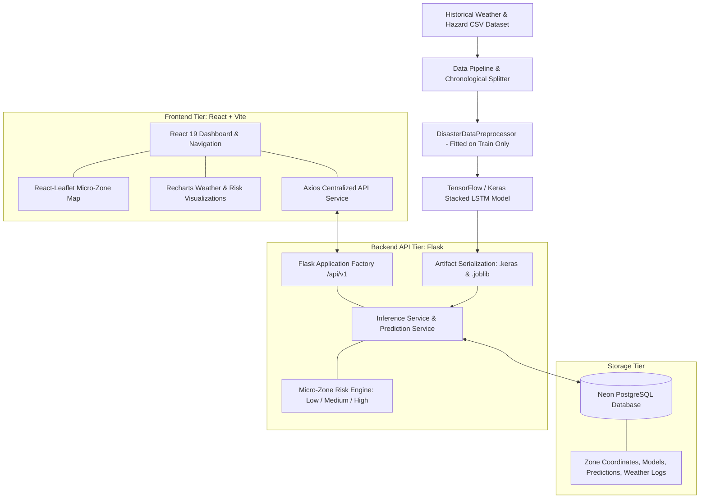

# System Architecture: AI Micro-Zone Disaster Prediction System

## 1. High-Level Architectural Overview

The system is architected as an academic decision-support platform designed to forecast localized hydrometeorological hazards (severe storms and flash floods) across discrete geographic micro-zones.

---

## 2. Component Breakdown

### 2.1 Frontend Tier (React + Vite)
- **Framework**: React.js with Vite builder for rapid compilation and hot-module reloading.
- **Styling**: Tailwind CSS with sleek, dark-mode glassmorphism and WCAG-accessible risk color coding.
- **Interactive Mapping**: React-Leaflet and Leaflet rendering geographic circle markers for micro-zones. Markers dynamically reflect computed hazard risk tiers (Emerald for Low, Amber for Medium, Crimson for High).
- **Charts & Trends**: Recharts multi-series area and donut charts displaying 24-hour meteorological trends and cross-zone risk distributions.
- **API Client**: Centralized Axios service with unified error interceptors and timeout protection.

### 2.2 Backend Tier (Python & Flask)
- **Framework**: Flask 3.x using the Application Factory pattern (`create_app()`).
- **Endpoints**: Organised across modular Blueprints with the `/api/v1` namespace:
  - `/health`: Safe dependency status (Database, ML model, Preprocessor).
  - `/dashboard/summary`: Aggregated counts, latest prediction timestamps, weather series.
  - `/zones`: Micro-zone coordinates, geographic metadata, observation history.
  - `/predictions`: Quantitative inference execution, paginated prediction audit trail.
  - `/datasets`: CSV dataset validation, null percentage analysis, duplicate detection.
  - `/reports`: Comparative zone risk statistics and live CSV streaming exports.
- **Validation**: Pydantic schemas validating input payloads, forecasting horizons, and dataset structures.

### 2.3 Database Tier (Neon PostgreSQL)
- **Platform**: Serverless Neon PostgreSQL accessed via SQLAlchemy ORM with SSL connection pooling (`sslmode=require`).
- **Fallback**: Zero-config SQLite engine enabled for local automated pytest suites and rapid development when `DATABASE_URL` is unconfigured.
- **Entities**:
  - `Zone`: Geospatial coordinates, elevation, population, topography, active status.
  - `WeatherObservation`: Hourly records for rainfall, temperature, humidity, wind, pressure, soil moisture.
  - `DisasterEvent`: Ground-truth historical hazard occurrences and descriptions.
  - `ModelVersion`: Model artifacts metadata, training dataset provenance, test set metrics.
  - `Prediction`: Model quantitative score, risk category, input feature snapshot, limitations disclaimers.
  - `DatasetMetadata`: File size, row count, detected columns, schema validation reports.
  - `User` & `AuditLog`: Security tracking and operational audit trail.

### 2.4 Machine Learning Tier (TensorFlow / Keras LSTM)
- **Model Architecture**:
  - Sequential Stacked LSTM: Layer 1 (64 units, return sequences), Dropout (0.2), Layer 2 (32 units), Dropout (0.2), Dense Feature Fusion (16 units, ReLU), Output (1 unit, Sigmoid).
- **Sequence Formation**: 24-hour lookback window across 6 continuous physical dimensions (`rainfall_mm`, `temperature_c`, `humidity_pct`, `wind_speed_kmh`, `pressure_hpa`, `soil_moisture_pct`).
- **Forecasting Horizon**: 24 hours ahead.
- **Evaluation**: Untouched chronological test set evaluated on ROC-AUC, accuracy, precision, recall, F1-score, and compared directly with a Logistic Regression baseline.

### 2.5 Micro-Zone Risk Engine
- **Low Risk**: Calibrated probability score `< 0.35` (Routine meteorological baseline).
- **Medium Risk**: Calibrated probability score `0.35 - 0.70` (Elevated warning threshold).
- **High Risk**: Calibrated probability score `≥ 0.70` (Critical hazard alert threshold).

### 2.6 Authority Emergency Alert Dispatch Engine
- **Auto-Trigger**: Any prediction classified as `HIGH` automatically triggers multi-channel emergency alert signals.
- **Recipient Authorities**:
  - `DDMA`: District Disaster Management Authority (Control: +91-1077, SMS Gateway)
  - `SEOC`: State Emergency Operation Centre (Toll-Free: +91-1070, Webhook Dispatch)
  - `NDRF`: National Disaster Response Force - 4th Bn (Control: +91-044-27473000, Broadcast Signal)
  - `GCC-ICCC`: City Municipal Integrated Command & Control Centre (Helpline: +91-1913, Municipal Relay)
- **Persistence**: Recorded in `alert_notifications` database table with timestamp, recipient, contact, and `DELIVERED` status.

### 2.7 Live Internet Weather Integration (Open-Meteo API)
- **Provider**: Free public Open-Meteo Meteorological API (zero API key required).
- **Capability**: Fetches past 24-hour real-time atmospheric measurements (`temperature_2m`, `precipitation`, `surface_pressure`, `wind_speed_10m`, `relative_humidity_2m`, `soil_moisture_0_to_1cm`) for any zone's latitude and longitude.
- **Workflow**: Persists observations into `WeatherObservation` table with idempotent upserts, allowing the Stacked LSTM model to evaluate live real-world weather on demand alongside the historical dataset.
